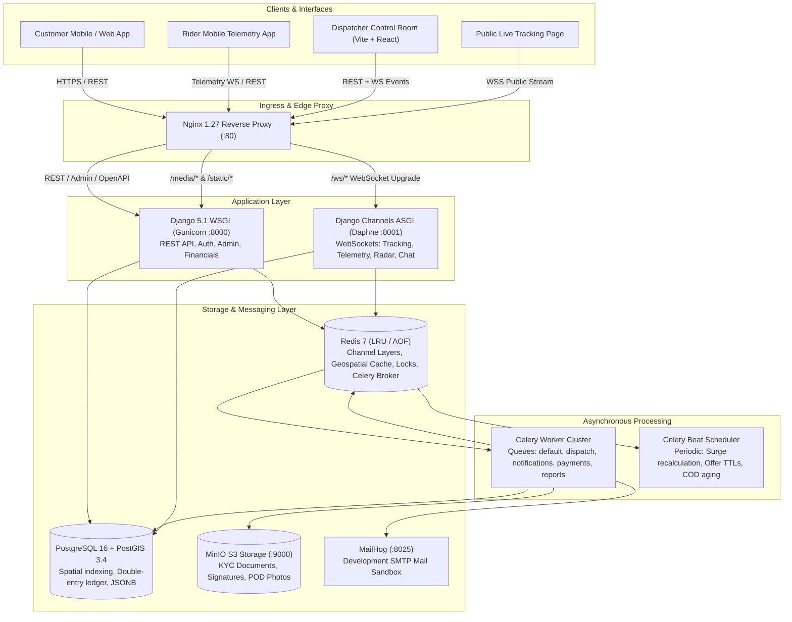
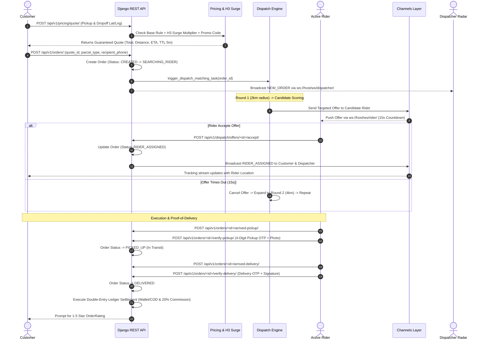
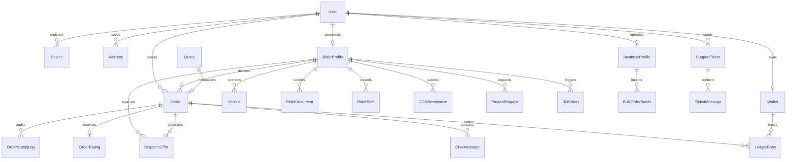

# Khan Parcel — Enterprise Real-Time Logistics & Fleet Dispatch Platform

[](https://www.python.org/)
[](https://www.djangoproject.com/)
[](https://www.django-rest-framework.org/)
[](https://channels.readthedocs.io/)
[](https://postgis.net/)
[](https://redis.io/)
[](https://docs.celeryq.dev/)
[](https://react.dev/)
[](https://vitejs.dev/)
[](https://tailwindcss.com/)
[](https://www.docker.com/)
[](#license)

---

## 📖 Table of Contents

- [Overview](#-overview)
- [System Architecture](#-system-architecture)
  - [High-Level Topology](#high-level-topology)
  - [Service Stack & Technology Map](#service-stack--technology-map)
  - [End-to-End Order & Dispatch Dataflow](#end-to-end-order--dispatch-dataflow)
- [Core Features & Subsystems](#-core-features--subsystems)
  - [1. Real-Time Geofencing & Telemetry](#1-real-time-geofencing--telemetry)
  - [2. Multi-Round Intelligent Dispatch Engine](#2-multi-round-intelligent-dispatch-engine)
  - [3. Dynamic Surge Pricing (Uber H3 Index)](#3-dynamic-surge-pricing-uber-h3-index)
  - [4. Double-Entry Accounting Ledger](#4-double-entry-accounting-ledger)
  - [5. Zero-Trust Security, Staff 2FA & KYC](#5-zero-trust-security-staff-2fa--kyc)
  - [6. Real-Time WebSockets & In-App Chat](#6-real-time-websockets--in-app-chat)
  - [7. B2B Corporate Portal & Bulk CSV Batches](#7-b2b-corporate-portal--bulk-csv-batches)
  - [8. Safety, SOS Alerting & Incident Support](#8-safety-sos-alerting--incident-support)
  - [9. Dispatcher Control Room & Operations Portal](#9-dispatcher-control-room--operations-portal)
- [Database Schema & ERD](#-database-schema--erd)
- [API & WebSocket Catalog](#-api--websocket-catalog)
  - [REST API Endpoints](#rest-api-endpoints)
  - [Realtime WebSocket Channels](#realtime-websocket-channels)
- [Directory Structure](#-directory-structure)
- [Getting Started](#-getting-started)
  - [Prerequisites](#prerequisites)
  - [Quickstart with Docker Compose](#quickstart-with-docker-compose)
  - [Local Development Setup (Non-Docker)](#local-development-setup-non-docker)
  - [Seeded Demo Accounts](#seeded-demo-accounts)
- [Operations, Simulation & Testing](#-operations-simulation--testing)
  - [Health Probes](#health-probes)
  - [Simulating a Full Day of Deliveries](#simulating-a-full-day-of-deliveries)
  - [Load Testing with Locust](#load-testing-with-locust)
  - [Running Unit & Integration Tests](#running-unit--integration-tests)
- [Configuration Reference](#-configuration-reference)
- [License](#-license)

---

## 🌟 Overview

**Khan Parcel** is an enterprise-grade, hyper-localized on-demand courier and parcel delivery platform engineered for ultra-low latency dispatch, high-frequency geospatial fleet telemetry, dynamic surge pricing, and audit-proof double-entry financial integrity.

Built for mission-critical logistics networks (seeded with full operational topology for Islamabad and Rawalpindi, Pakistan), the system handles the complete lifecycle from instant distance-matrix route quotation and multi-tier vehicle dispatch (Bikes, Cars, Vans, Trucks) to OTP/signature verified custody handoffs and automated cash-on-delivery (COD) reconciliation.

```
+---------------------------------------------------------------------------------------+
|                                    KHAN PARCEL PLATFORM                               |
+---------------------------------------------------------------------------------------+
|  Dispatch Radar   |  Expanding Radius Matching  |  Uber H3 Surge Multipliers          |
|  Double-Entry     |  2FA Staff & Phone OTP KYC  |  WebSockets & Presigned MinIO Media |
|  B2B Bulk CSV     |  SOS Realtime Breadcrumbs   |  Prometheus Metrics & Celery Queues |
+---------------------------------------------------------------------------------------+
```

---

## 🏗️ System Architecture

### High-Level Topology



### Service Stack & Technology Map

| Layer | Technology | Version | Purpose |
| :--- | :--- | :--- | :--- |
| **Edge Ingress** | Nginx | 1.27 Alpine | TLS termination, gzip/brotli compression, rate limiting, WS reverse proxy |
| **Web API (WSGI)** | Python / Django / DRF | 3.12 / 5.1 / 3.15 | REST endpoints, OpenAPI schemas, Django ORM, Admin interface |
| **Realtime (ASGI)** | Django Channels / Daphne | 4.1 / 4.1 | Asynchronous WebSocket connection pooling and Redis broadcast channel layers |
| **Spatial Database** | PostgreSQL + PostGIS | 16-3.4 | Geospatial PointFields, ST_DWithin calculations, spatial indexing |
| **Cache & Broker** | Redis | 7 Alpine | Channel layer backend, Celery task broker, rider location caching, session storage |
| **Background Tasks** | Celery / Celery Beat | 5.4 / 2.6 | Asynchronous dispatch offer timeouts, surge updates, PDF generation, push alerts |
| **Object Storage** | MinIO (S3 Compatible) | Latest | Presigned private URLs for driver CNIC/licence KYC and delivery proofs |
| **Frontend Portal** | React / Vite / Tailwind | 18.3 / 5.0 / 3.4 | Dispatch radar, fleet tracking map, financial statement viewer, bulk upload |
| **Observability** | Prometheus / Sentry / Structlog | Latest | Endpoint performance metrics, distributed tracing, structured JSON logging |

---

### End-to-End Order & Dispatch Dataflow



---

## ⚡ Core Features & Subsystems

### 1. Real-Time Geofencing & Telemetry
- **High-Frequency GPS Ingestion**: Riders stream telemetry directly over `/ws/rider/` or via `POST /api/v1/riders/location/`. Each ping updates the driver's PostGIS `PointField`, stores the current position in Redis geospatial structures, and broadcasts to active order rooms and dispatchers.
- **Geofence Arrival Triggers**: Proximity checks (configurable via `GEOFENCE_RADIUS_METERS=150`) automatically detect when a rider is within range of the pickup or dropoff waypoint to trigger automated notifications.
- **Battery & Heartbeat Monitoring**: Every ping monitors driver battery status, device model, and network latency, automatically toggling inactive riders to `OFFLINE` after heartbeat expiration.

### 2. Multi-Round Intelligent Dispatch Engine
- **Expanding Radius Strategy**: If no candidate accepts within the active radius, the engine expands search rings:
  $$\text{Rounds} = [2\,\text{km} \rightarrow 4\,\text{km} \rightarrow 7\,\text{km} \rightarrow 10\,\text{km}]$$
- **Multi-Factor Scoring Matrix**:
  $$\text{Candidate Score} = w_1 \cdot \text{ETA} + w_2 \cdot \text{Rating} + w_3 \cdot \text{AcceptanceRate} + w_4 \cdot \text{IdleTime} + w_5 \cdot \text{LoadFactor}$$
  *(Configurable weights in `.env`: `DISPATCH_SCORE_W1` through `W6`).*
- **Strict 15-Second Offer TTL**: Offers are dispatched asynchronously with exact Celery countdown timers. If a rider declines or lets the timer lapse, the offer is retracted and granted to the next candidate.
- **Dispatcher Manual Override**: Dispatchers in the Control Room can bypass automated matching to force-assign orders directly to specific drivers.

### 3. Dynamic Surge Pricing (Uber H3 Index)
- **Hexagonal Spatial Partitioning**: Operates using Uber's **H3 Hierarchical Spatial Index** at Resolution 8 (~460-meter hexagon edge length).
- **Supply / Demand Elasticity**: Calculates the ratio of unassigned orders (demand) to online idle drivers (supply) within each hexagon cell.
- **Exponential Moving Average (EMA)**: Smooths wild spikes across consecutive recalculation intervals (`SURGE_EMA_ALPHA=0.3`), capping maximum surge multiplier at `2.5x`.
- **Quote Lock**: Customer pricing quotes lock in surge rates for 300 seconds (`QUOTE_EXPIRY_SECONDS=300`) with tolerance for surge drift.

### 4. Double-Entry Accounting Ledger
- **Zero-Sum Mathematical Guarantee**: Financial mutations are never stored as single floating-point numbers. Every transaction generates paired credit and debit entries across ledger accounts:
  - `Customer Prepaid Wallet` $\leftrightarrow$ `Platform Escrow Holding`
  - `Platform Escrow Holding` $\leftrightarrow$ `Driver Earnings Wallet`
  - `Driver Earnings Wallet` $\leftrightarrow$ `Platform Commission Revenue (20%)`
  - `Driver COD Holding` $\leftrightarrow$ `Platform Settlement Account`
- **Cash on Delivery (COD) Remittance**: Drivers collect cash from recipients and record physical bank deposits with slip images. Operations staff verify and release holds via the financials console.
- **Payout Requests**: Seamless driver wallet withdrawal requests with bank account validation and administrative review.

### 5. Zero-Trust Security, Staff 2FA & KYC
- **Two-Factor Authentication (2FA)**: Mandatory TOTP (RFC 6238) for staff roles (Admin, Dispatcher, Support) compatible with Google Authenticator, Authy, and 1Password.
- **Cryptographic Phone OTP**: Customer and driver authentication utilizes 6-digit OTP codes stored as salted SHA-256 digests. Enforces maximum 5 attempts, 5-minute expiry, and a mandatory 30-second cooldown between resends.
- **Brute-Force Attack Mitigation**: Protected by `django-axes` with IP/user tracking, blocking access after 5 consecutive failures with a 15-minute cooldown.
- **Private S3 / MinIO KYC Buckets**: Sensitive KYC media (driver CNIC cards, driving licenses, vehicle registrations) are strictly private and accessible only via short-lived 15-minute presigned URLs.

### 6. Real-Time WebSockets & In-App Chat
- **Channels Architecture**: Powered by Django Channels 4 with Daphne ASGI and Redis Channel Layers.
- **Dedicated Channels**:
  - `ws/tracking/<order_id>/`: Real-time order progress and rider GPS updates for authenticated customers.
  - `ws/public/tracking/<token>/`: Zero-auth public shareable link for order recipients.
  - `ws/dispatcher/`: Live control room event stream (fleet positions, pending orders, alerts).
  - `ws/rider/`: Private driver dispatch offer alerts and background telemetry.
  - `ws/chat/<order_id>/`: Ephemeral order-scoped chat between customer, assigned driver, and support.

### 7. B2B Corporate Portal & Bulk CSV Batches
- **Corporate Client Accounts**: Businesses can register Corporate Profiles with custom billing cycles, tax identification numbers (NTN), and pre-approved credit limits.
- **Bulk CSV Ingestion**: Upload spreadsheets containing hundreds of delivery orders. Celery workers parse, validate addresses, calculate batch quotes, and materialize orders asynchronously.
- **Custom Tariffs**: Support for negotiated corporate volume discount rules.

### 8. Safety, SOS Alerting & Incident Support
- **One-Tap Emergency SOS**: In distress, riders tap SOS to broadcast emergency coordinates and recent GPS breadcrumbs to the control room with high-priority audio-visual alerts.
- **Integrated Support Ticketing**: Comprehensive ticket management linked to specific orders, riders, or corporate accounts with status tracking (`OPEN`, `INVESTIGATING`, `RESOLVED`).

### 9. Dispatcher Control Room & Operations Portal
A comprehensive Single-Page Application (SPA) built with React 18, Vite, and Tailwind CSS containing 6 distinct operational consoles:
1. **Live Dispatch Radar**: Interactive map tracking available/busy riders, unassigned orders, and real-time candidate offer countdowns.
2. **Orders Auditor**: Filter orders by status, parcel type, date, or customer; drill down into full state-change audit logs and proof photos.
3. **Fleet Roster & KYC**: Review pending driver driver licenses, CNIC identity submissions, vehicle inspection statuses, and toggle driver bans.
4. **Financials & Remittance**: Reconcile driver COD cash collections against bank deposit slips, authorize payouts, and inspect balanced ledger journals.
5. **B2B Client Management**: Corporate credit allowances, invoicing, and bulk batch processing monitors.
6. **Surge Pricing Simulator**: Visualizer for active H3 hexagonal demand hotspots and manual surge multiplier testing.

---

## 📊 Database Schema & ERD



---

## 📡 API & WebSocket Catalog

### REST API Endpoints

#### Authentication & Account Management (`/api/v1/auth/`)
| Method | Endpoint | Description | Auth Required |
| :--- | :--- | :--- | :--- |
| `POST` | `/api/v1/auth/otp/request/` | Request 6-digit SMS OTP | None |
| `POST` | `/api/v1/auth/otp/verify/` | Verify OTP; returns JWT access/refresh tokens | None |
| `POST` | `/api/v1/auth/token/refresh/`| Refresh expired JWT token | None |
| `POST` | `/api/v1/auth/staff/login/` | Staff login (Email + Password + TOTP 2FA) | None |
| `GET/PUT` | `/api/v1/auth/profile/` | Inspect and edit authenticated user profile | User |
| `POST` | `/api/v1/auth/devices/register/` | Register mobile FCM push notification token | User |
| `POST` | `/api/v1/auth/2fa/setup/` | Generate TOTP QR code secret for staff | Staff |

#### Fleet & Riders (`/api/v1/riders/`)
| Method | Endpoint | Description | Auth Required |
| :--- | :--- | :--- | :--- |
| `GET` | `/api/v1/riders/me/` | Current rider status, vehicle, and stats | Rider |
| `POST` | `/api/v1/riders/onboard/` | Submit vehicle info and CNIC profile | Rider |
| `POST` | `/api/v1/riders/documents/upload/` | Upload KYC documents (CNIC / License) | Rider |
| `POST` | `/api/v1/riders/status/toggle/` | Switch status between AVAILABLE and OFFLINE | Rider |
| `POST` | `/api/v1/riders/location/` | High-frequency telemetry GPS ping | Rider |
| `POST` | `/api/v1/riders/admin/documents/<id>/review/` | Staff review & approve/reject KYC | Staff |

#### Pricing & Quotes (`/api/v1/pricing/`)
| Method | Endpoint | Description | Auth Required |
| :--- | :--- | :--- | :--- |
| `POST` | `/api/v1/pricing/quote/` | Calculate route distance, surge, duration & price | User / B2B |
| `GET` | `/api/v1/pricing/quote/<id>/` | Fetch details of a calculated quote | User / B2B |
| `POST` | `/api/v1/pricing/promo/validate/`| Validate promo code eligibility | User |
| `GET` | `/api/v1/pricing/rules/` | View base price rules and vehicle tariffs | None |

#### Delivery Orders (`/api/v1/orders/`)
| Method | Endpoint | Description | Auth Required |
| :--- | :--- | :--- | :--- |
| `GET` | `/api/v1/orders/` | List orders (filtered by customer/driver/staff) | User |
| `POST` | `/api/v1/orders/` | Materialize delivery order from valid quote | User |
| `GET` | `/api/v1/orders/<id>/` | Order details, current status, and audit logs | User |
| `POST` | `/api/v1/orders/<id>/arrived-pickup/` | Driver signals arrival at pickup location | Rider |
| `POST` | `/api/v1/orders/<id>/verify-pickup/` | Verify 4-digit pickup OTP & proof photo | Rider |
| `POST` | `/api/v1/orders/<id>/arrived-delivery/` | Driver signals arrival at dropoff destination | Rider |
| `POST` | `/api/v1/orders/<id>/verify-delivery/` | Verify delivery OTP, customer signature & complete | Rider |
| `POST` | `/api/v1/orders/<id>/cancel/` | Cancel order with structured reason code | User / Staff |
| `POST` | `/api/v1/orders/<id>/rate/` | Customer submits 1-5 star rating and review | Customer |

#### Dispatch Engine (`/api/v1/dispatch/`)
| Method | Endpoint | Description | Auth Required |
| :--- | :--- | :--- | :--- |
| `GET` | `/api/v1/dispatch/offers/` | List rider's active pending offers | Rider |
| `POST` | `/api/v1/dispatch/offers/<id>/accept/` | Rider accepts delivery offer | Rider |
| `POST` | `/api/v1/dispatch/offers/<id>/reject/` | Rider declines offer | Rider |
| `POST` | `/api/v1/dispatch/manual-assign/` | Control Room manual assignment override | Dispatcher |

#### Financials & Payments (`/api/v1/payments/`)
| Method | Endpoint | Description | Auth Required |
| :--- | :--- | :--- | :--- |
| `GET` | `/api/v1/payments/wallet/` | Current user wallet balance | User |
| `POST` | `/api/v1/payments/wallet/topup/` | Add prepaid funds to customer wallet | User |
| `GET` | `/api/v1/payments/wallet/statement/`| Balanced double-entry financial statement | User |
| `POST` | `/api/v1/payments/payouts/` | Rider submits withdrawal request | Rider |
| `POST` | `/api/v1/payments/cod/remit/` | Rider submits bank deposit slip for COD | Rider |
| `POST` | `/api/v1/payments/admin/cod/<id>/verify/` | Staff verifies COD bank deposit slip | Staff |

---

### Realtime WebSocket Channels

All WebSocket connections support standard token parameter authentication: `?token=<JWT_ACCESS_TOKEN>`.

```
ws://host/ws/tracking/<order_id>/?token=<jwt>     -> Customer live order tracking & rider GPS
ws://host/ws/public/tracking/<token>/             -> Anonymous public shareable tracking page
ws://host/ws/dispatcher/?token=<jwt>              -> Control Room real-time fleet & dispatch radar
ws://host/ws/rider/?token=<jwt>                   -> Rider private telemetry & dispatch offers
ws://host/ws/chat/<order_id>/?token=<jwt>         -> In-app real-time messaging between parties
```

**Example Rider Location Payload (sent over `/ws/rider/`):**
```json
{
  "type": "telemetry_ping",
  "latitude": 33.7297,
  "longitude": 73.0746,
  "heading": 142.5,
  "speed_kmh": 34.2,
  "battery_level": 88
}
```

---

## 📂 Directory Structure

```text
khanparcel/
├── apps/
│   ├── accounts/             # User auth, roles, TOTP 2FA, SMS OTP, phone verification
│   ├── business/             # B2B Corporate profiles, bulk CSV batches, corporate billing
│   ├── chat/                 # In-app messaging models, message persistence, chat history
│   ├── core/                 # Abstract base models, GIS compatibility, health checks, seeders
│   ├── dispatch/             # Multi-round matching engine, scoring algorithm, offer timers
│   ├── notifications/        # FCM push notifications, Twilio SMS, transactional emails
│   ├── orders/               # Order lifecycle, state machine, proof-of-delivery, ratings
│   ├── payments/             # Double-entry ledger, wallets, COD remittance, payout processing
│   ├── pricing/              # Pricing rules, H3 hexagon surge calculations, quotes, promo codes
│   ├── realtime/             # Django Channels WebSocket consumers & connection routing
│   ├── reports/              # Ops analytics, PDF generation, CSV reporting, metrics
│   ├── riders/               # Rider profiles, vehicle registration, KYC document reviews
│   ├── support/              # Support tickets, SOS emergency alerts, incident management
│   └── tracking/             # Public tracking URLs, breadcrumbs, live ETA calculations
├── config/
│   ├── settings/
│   │   ├── base.py           # Universal Django settings (apps, middleware, auth)
│   │   ├── dev.py            # Development overrides (SQLite/Postgres toggle, debug flags)
│   │   ├── prod.py           # Production security hardening (SSL, Sentry, WhiteNoise)
│   │   └── test.py           # Fast in-memory testing settings
│   ├── asgi.py               # ASGI application entrypoint for Daphne (WebSockets)
│   ├── wsgi.py               # WSGI application entrypoint for Gunicorn (HTTP)
│   ├── celery.py             # Celery broker initialization and queue definitions
│   ├── routing.py            # Root Channels WebSocket URL routing
│   └── urls.py               # Root REST API URL dispatching & Swagger/OpenAPI setup
├── docs/
│   ├── API.md                # Comprehensive REST API catalog & request payloads
│   ├── ARCHITECTURE.md       # High-level architecture and system design document
│   ├── ERD.md                # Database entity relationship diagrams & model keys
│   └── RUNBOOK.md            # Production operations, security protocols, and deployment
├── nginx/
│   ├── nginx.conf            # High-performance reverse proxy & gzip configuration
│   └── conf.d/               # Virtual host configurations for HTTP & WebSockets
├── portal/                   # Control Room & Operations Single Page Application
│   ├── src/
│   │   ├── App.jsx           # Main React application with 6 operations tabs
│   │   ├── api.js            # Axios client with JWT refresh interceptors
│   │   └── index.css         # Tailwind CSS styling and theme definitions
│   ├── package.json          # Vite + React 18 dependencies
│   └── vite.config.js        # Vite bundler configuration
├── scripts/
│   ├── locustfile.py         # Locust performance and load-testing scenario
│   └── simulate_day.py       # Full operational day multi-order automated simulator
├── .env.example              # Environment variables template
├── docker-compose.yml        # Multi-container orchestration (10 coordinated services)
├── Dockerfile                # Production multi-stage Python 3.12 container definition
├── Makefile                  # Developer CLI shortcuts for build, test, seed, and run
├── manage.py                 # Django administrative execution script
└── pyproject.toml            # Poetry / Pip build dependencies and tool configurations
```

---

## 🚀 Getting Started

### Prerequisites

Ensure you have the following installed on your host machine:
- **Docker Desktop** (v24.0+ recommended) and **Docker Compose v2**
- **Git**
- *(Optional for bare-metal run)*: **Python 3.12+**, **Node.js 18+**, and **PostgreSQL 16 + PostGIS**

---

### Quickstart with Docker Compose

Khan Parcel is fully containerized. A single command boots the entire fleet infrastructure:

#### Step 1: Clone the repository and configure environment
```bash
# Navigate to the project directory
cd khanparcel

# Copy the environment template
cp .env.example .env
```

#### Step 2: Build and start all services
```bash
docker compose up -d --build
```

#### Step 3: Run database migrations
```bash
docker compose exec web python manage.py migrate
```

#### Step 4: Seed demo data (Islamabad / Rawalpindi Fleet)
```bash
docker compose exec web python manage.py seed_khanparcel
```

#### Step 5: Access the Platform
Once started, the following services are live:

| Component | URL | Default Credentials |
| :--- | :--- | :--- |
| **Control Room / Web Portal** | [http://localhost](http://localhost) or [http://localhost:5173](http://localhost:5173) | Pre-authenticated or use Staff login |
| **Django Admin** | [http://localhost/admin/](http://localhost/admin/) | Phone: `+923000000001` / Pass: `Admin@123456` |
| **OpenAPI Swagger UI** | [http://localhost/api/docs/](http://localhost/api/docs/) | Open access |
| **OpenAPI ReDoc** | [http://localhost/api/redoc/](http://localhost/api/redoc/) | Open access |
| **MinIO S3 Web Console** | [http://localhost:9001](http://localhost:9001) | User: `minioadmin` / Pass: `minioadmin` |
| **MailHog Sandbox** | [http://localhost:8025](http://localhost:8025) | Open access |
| **Liveness Health Probe** | [http://localhost/healthz/](http://localhost/healthz/) | Status: 200 OK |
| **Readiness Health Probe**| [http://localhost/readyz/](http://localhost/readyz/) | Status: 200 OK (DB, Redis, Celery) |

---

### Local Development Setup (Non-Docker)

If running directly on a local workstation:

1. **Create and activate a virtual environment**:
   ```bash
   python -m venv .venv
   source .venv/bin/activate  # On Windows: .venv\Scripts\activate
   pip install -e ".[dev]"
   ```

2. **Configure local environment variables**:
   Create a `.env` file with `DJANGO_SETTINGS_MODULE=config.settings.dev`.

3. **Start backend services**:
   ```bash
   python manage.py migrate
   python manage.py seed_khanparcel
   python manage.py runserver 8000
   ```

4. **Start the Frontend Portal**:
   ```bash
   cd portal
   npm install
   npm run dev
   ```

---

### Seeded Demo Accounts

The `seed_khanparcel` command configures realistic users, pricing rules, promo codes, and 10 active delivery riders stationed across Islamabad and Rawalpindi:

| Role | Phone | Email / Identifier | Password | Description |
| :--- | :--- | :--- | :--- | :--- |
| **Super Admin** | `+923000000001` | `admin@khanparcel.com` | `Admin@123456` | Full platform control & superuser |
| **Dispatcher** | `+923000000002` | `dispatcher@khanparcel.com` | `Dispatcher@123456` | Live Control Room operator |
| **Active Rider 1** | `+923010000000` | Zubair Khan (Honda CD70) | N/A (OTP) | Stationed at F-6 Markaz |
| **Active Rider 2** | `+923010000001` | Hamza Farooq (Honda CD70) | N/A (OTP) | Stationed at F-7 Jinnah Super |
| **Active Rider 3** | `+923010000002` | Bilal Mustafa (Honda CD70) | N/A (OTP) | Stationed at F-8 Markaz |
| **Customer** | `+923009998877` | Test Customer | N/A (OTP) | Pre-seeded with completed orders |

---

## 🛠️ Operations, Simulation & Testing

### Health Probes

The application provides standardized container health and readiness probes:

- **Liveness Probe**:
  ```bash
  curl -i http://localhost/healthz/
  # HTTP/1.1 200 OK -> {"status": "ok"}
  ```

- **Readiness Probe** (validates PostgreSQL, Redis, and Celery worker health):
  ```bash
  curl -i http://localhost/readyz/
  # HTTP/1.1 200 OK -> {"status": "ready", "checks": {"database": "ok", "redis": "ok", "celery": "ok"}}
  ```

---

### Simulating a Full Day of Deliveries

Khan Parcel includes an automated multi-threaded operational day simulator that models realistic lifecycle events (quotes, order materialization, multi-round dispatch offers, rider GPS movement, pickup photo verification, and delivery completion):

```bash
# Simulate 5 concurrent customer orders through full lifecycle
docker compose exec web python scripts/simulate_day.py 5
```

---

### Load Testing with Locust

Stress-test the quotation and dispatch endpoints:

```bash
# Run headless Locust load test with 50 concurrent users
docker compose exec web locust -f scripts/locustfile.py --headless -u 50 -r 5 -t 1m --host http://localhost:8000
```

---

### Running Unit & Integration Tests

Execute the automated test suite with coverage enforcement:

```bash
# Using Makefile
make test

# Or directly with Docker
docker compose exec web pytest --cov=apps --cov-report=term-missing
```

Code formatting and quality checks:
```bash
# Ruff linter
docker compose exec web ruff check .

# Black code formatter
docker compose exec web black --check .

# Mypy strict type checks
docker compose exec web mypy apps config
```

---

## ⚙️ Configuration Reference

Key environment variables configurable in `.env`:

| Variable | Default Value | Description |
| :--- | :--- | :--- |
| `DJANGO_SETTINGS_MODULE` | `config.settings.dev` | Django settings profile (`dev`, `prod`, `test`) |
| `POSTGRES_DB` | `khanparcel` | PostgreSQL database name |
| `POSTGRES_USER` | `khanparcel` | PostgreSQL database user |
| `POSTGRES_PASSWORD` | `khanparcel_secret` | PostgreSQL password |
| `REDIS_URL` | `redis://redis:6379/0` | Primary Redis database URL |
| `REDIS_CELERY_URL` | `redis://redis:6379/2` | Celery broker URL |
| `JWT_ACCESS_TOKEN_LIFETIME_MINUTES` | `15` | JWT session access validity window |
| `OTP_TTL_SECONDS` | `300` | OTP code lifetime (5 minutes) |
| `OTP_RESEND_COOLDOWN_SECONDS` | `30` | Minimum interval between SMS resends |
| `DISPATCH_MAX_ROUNDS` | `4` | Maximum expanding search rings |
| `DISPATCH_RADII_KM` | `2,4,7,10` | Radii for rounds 1, 2, 3, and 4 in kilometers |
| `DISPATCH_OFFER_TTL_SECONDS`| `15` | Rider response time limit before offer retraction |
| `SURGE_H3_RESOLUTION` | `8` | Uber H3 hexagon resolution size |
| `SURGE_MAX_MULTIPLIER` | `2.5` | Maximum dynamic surge ceiling |
| `GEOFENCE_RADIUS_METERS` | `150` | Arrival detection proximity threshold |
| `AWS_STORAGE_BUCKET_NAME` | `khanparcel-media`| S3/MinIO bucket for private KYC and POD media |

---

## 📄 License

This codebase and associated assets are proprietary to **Khan Parcel Engineering**. Unauthorized copying, distribution, or commercial modification without express written consent is strictly prohibited.

