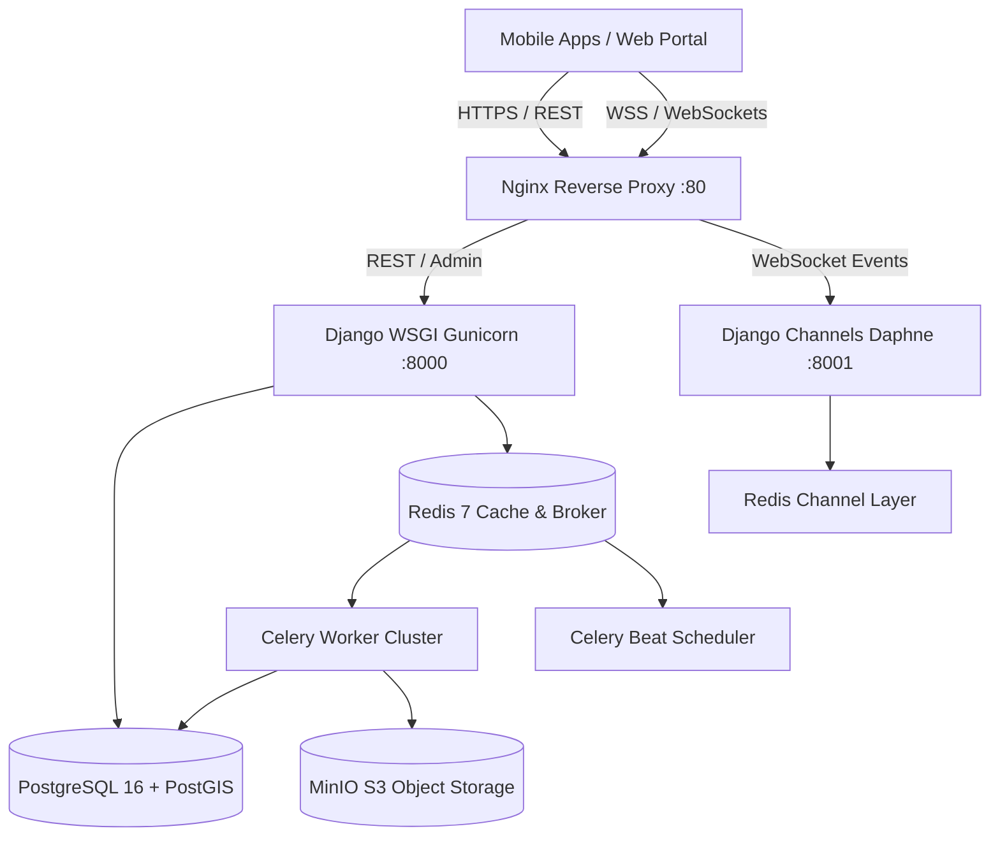

# Khan Parcel — System Architecture Documentation

## 1. High-Level Architecture Overview

Khan Parcel is an enterprise real-time on-demand logistics and delivery platform engineered for ultra-low latency dispatch, geospatial fleet management, and double-entry financial integrity.

---

## 2. Core Architectural Pillars

### A. Real-Time Geofencing & Telemetry
- **Rider Telemetry**: High-frequency GPS pings stream over WebSocket (`/ws/rider/`) directly into Redis and broadcast to the Dispatcher Room (`dispatchers`) and active customer tracking channel (`order_<id>`).
- **Dynamic Surge Pricing**: Spatial partitioning using Uber **H3 Hexagonal Hierarchical Spatial Index** (Resolution 8). Demand (unassigned orders) and Supply (idle riders) calculate localized multipliers up to 2.5x.

### B. Intelligent Dispatch Matching Engine
- Multi-round expanding radius algorithm: Round 1 (2km), Round 2 (4km), Round 3 (7km), Round 4 (10km).
- Candidate scoring equation:
  $$\text{Score} = w_1 \cdot \text{ETA} + w_2 \cdot \text{Rating} + w_3 \cdot \text{AcceptanceRate} + w_4 \cdot \text{IdleTime} + w_5 \cdot \text{LoadFactor}$$
- Strict 15-second TTL per offer enforced asynchronously by Celery timers.

### C. Double-Entry Accounting Ledger
- Every financial movement (prepaid card debit, driver wallet credit, cash on delivery holding, platform 20% commission deduction) creates immutable balanced debit and credit entries. Zero-sum integrity is guaranteed.

### D. Zero-Trust Security & KYC
- Staff 2FA via Time-Based One-Time Password (TOTP RFC 6238).
- Customer/Rider phone authentication with cryptographic SHA-256 OTP hashing and brute-force lockouts.
- S3 15-minute temporary signed URLs for sensitive KYC identity documents.
