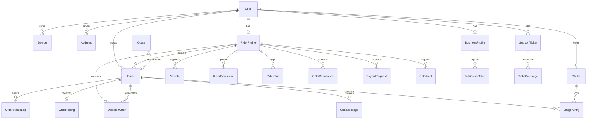

# Khan Parcel — Entity Relationship Diagram (ERD)

---

## Model Inventory & Keys

| App | Primary Model | Keys & Key Relations |
| :--- | :--- | :--- |
| **Accounts** | `User` | PK: UUID, Phone: Unique E.164, ArrayField: Roles |
| | `Device` | FK: User, FCM Token |
| | `Address` | FK: User, PointField (lat/lng) |
| **Riders** | `RiderProfile` | OneToOne: User, PointField (location), Status |
| | `Vehicle` | FK: RiderProfile, VehicleType (BIKE, CAR, VAN, TRUCK) |
| | `RiderDocument` | FK: RiderProfile, DocumentType, Status |
| **Pricing** | `PriceRule` | VehicleType, Base Fare, KM Rate, Minute Rate |
| | `SurgeCell` | H3 Index (Hexagon), Multiplier |
| | `Quote` | Points (Pickup/Dropoff), Total Price, Expiry |
| **Orders** | `Order` | FK: Customer, FK: Rider, FK: Quote, State Machine |
| | `OrderStatusLog`| FK: Order, Old Status, New Status |
| | `OrderRating` | OneToOne: Order, 1-5 Score |
| **Dispatch**| `DispatchOffer` | FK: Order, FK: Rider, Round, Score, Status |
| **Payments**| `Wallet` | OneToOne: User, Balance |
| | `LedgerEntry` | FK: Wallet, FK: Order, Double-Entry Debit/Credit |
| | `CODRemittance`| FK: Rider, Amount, Deposit Slip |
| | `PayoutRequest` | FK: Rider, Bank Account, Status |
| **Realtime**| `ChatMessage` | FK: Order, Sender User, Text |
| **Support** | `SupportTicket` | FK: User, Priority, Status |
| | `SOSAlert` | FK: Rider, PointField, Reason |
| **Business**| `BusinessProfile`| OneToOne: User, NTN, Credit Limit |
| | `BulkOrderBatch` | FK: BusinessProfile, CSV File, Row Stats |
